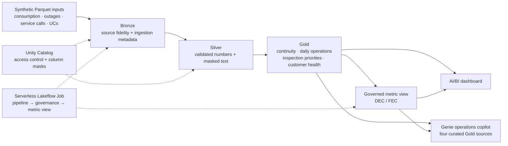

# Grid Intelligence

[](https://github.com/rafacorte1/grid_intelligence_databricks/actions/workflows/tests.yml)

**A governed Databricks lakehouse and operations copilot for a fictional electric utility.**

Grid Intelligence connects power interruptions, daily electricity consumption and customer
service calls to operational decisions. It demonstrates data engineering, semantic modeling,
privacy controls and natural language analytics in one workflow.

Every number in this repository comes from a synthetic dataset built for the project. The
utility is fictional, the deployment is development-only, and nothing here is a claim of
production readiness, prevented losses or financial savings.

## What the project demonstrates

- **Lakehouse engineering:** Bronze → Silver → Gold pipelines with explicit grains,
  plausibility checks, deduplication and dataset-relative analysis windows.
- **Governed analytics:** one metric view defines DEC/FEC for both the dashboard and the
  conversational interface, so there are no competing KPI calculations.
- **Privacy-aware processing:** access-controlled original transcripts coexist with masked
  text for analytics. Deterministic rules expose their limitations instead of hiding them.
- **Decision support:** inspection priorities combine an individual consumption drop with
  neighborhood stability. They guide technical visits, not accusations.
- **Conversational evaluation:** a Portuguese Genie copilot uses four curated Gold sources
  and is tested through the Conversation API, including an adversarial question.
- **Deployment as code:** Declarative Automation Bundles manage platform resources; the Genie
  definition is versioned and applied by an idempotent Python/CLI script.

## Architecture



**Stack:** Databricks SQL, Delta Lake, Unity Catalog, Lakeflow Spark Declarative Pipelines,
Lakeflow Jobs, serverless compute, metric views, AI/BI dashboards, Genie, Python and the
Databricks CLI. Text enrichment uses deterministic regex rules; this project does not train
a supervised classification model.

## Evidence from the synthetic dataset

| Item | Observed result |
| --- | ---: |
| Consumption records ingested | 5,854,587 |
| Valid, unique UC/day consumption records | 5,803,274 |
| Electricity delivery points (UCs) | 4,000 |
| Service calls preserved | 2,801 |
| Interruption events eligible for continuity | 1,073 |
| District/month combinations | 288 |
| High-priority inspection candidates | 21 |

These are dataset and validation results, not claims of prevented losses, reduced costs or
model accuracy. Read the [validation report](grid_intelligence/docs/validation.md) for what
was checked and what remains limited.

## Business semantics

A **UC** (unidade consumidora) is an electricity delivery point; one customer can have
multiple UCs. A **conjunto** is an electrical district. **DEC** is average interruption
duration per UC, in hours; **FEC** is average interruption frequency per UC. These are
Brazilian continuity indicators related to the SAIDI/SAIFI family of metrics. **PNT** means
non-technical losses. Inspection priority is a triage signal and does not establish
misconduct or quantify losses.

Relative dates use the latest available dataset date. The sample ends in July 2026; querying
the wall clock would incorrectly return empty results. Inspection priorities are a current
snapshot, so their KPI has one dated point rather than an invented historical trend.

## Run the project

Prerequisites: Python 3.12+, a current Databricks CLI, an authenticated profile, Unity Catalog
permissions, serverless pipeline availability and a SQL warehouse. Raw synthetic fixtures are
supplied separately and are intentionally excluded from Git. The repository does not include a
fixture generator.

```bash
cd grid_intelligence
databricks auth login --profile grid_intelligence
export BUNDLE_VAR_warehouse_id='<YOUR_SQL_WAREHOUSE_ID>'
databricks bundle validate --strict -t dev --profile grid_intelligence
databricks bundle deploy -t dev --profile grid_intelligence
# Upload the synthetic inputs before the first pipeline run.
databricks bundle run grid_intelligence_atualizar -t dev --profile grid_intelligence
```

The CLI profile supplies the workspace host. Catalogs are selected in `databricks.yml`. The
`atendimento` account group must exist and include the job identity before the masking task can
run. See the [operating guide](grid_intelligence/docs/operations.md) for input paths,
governance prerequisites, dashboard publishing and Genie setup.

```bash
python3 -m unittest discover -s tests -p 'test_*.py'
python3 tests/verificar_dashboard.py --profile grid_intelligence \
  --catalog grid_dev --schema gold --warehouse "$BUNDLE_VAR_warehouse_id"
python3 scripts/aplicar_genie.py --profile grid_intelligence --target dev
python3 scripts/testar_genie.py --profile grid_intelligence --target dev
```

The Genie apply script executes its four example SQL queries before creating or updating the
space. Detailed API evidence defaults to the ignored `.databricks/evidence/` path. Workspace
URLs and conversation exports are local artifacts, not public demo links.

## Repository map

| Path | Purpose |
| --- | --- |
| `grid_intelligence/resources/` | Bundle-managed schemas, volume, pipeline, job and dashboard |
| `grid_intelligence/src/pipelines/` | Bronze, Silver and Gold SQL transformations |
| `grid_intelligence/src/sql/` | Column-mask setup and the continuity metric view |
| `grid_intelligence/src/dashboards/` | Versioned native AI/BI dashboard definition |
| `grid_intelligence/src/genie/` | Portable Genie definition with `${catalogo}` |
| `grid_intelligence/scripts/` | Genie apply and Conversation API evaluation |
| `grid_intelligence/tests/` | Data/governance acceptance SQL and local script tests |
| `grid_intelligence/prompts/` | Implementation requirements and business rules |
| `grid_intelligence/docs/` | Validation, privacy review, operations and Genie evaluation |

## Validation and limitations

- [Development validation and known limits](grid_intelligence/docs/validation.md)
- [Privacy and publication review](grid_intelligence/docs/security-review.md)
- [Genie Conversation API evaluation](grid_intelligence/docs/genie-evaluation.md)

The demo runs in development. Production deployment, non-member access testing and a broader
conversational benchmark remain future work. Treat the system as a development demonstration,
not as production-ready or universally anonymized.

## Language note

Business rules, table and column names, and copilot responses are in Brazilian Portuguese
because the domain is a Brazilian utility. The dashboard labels and all documentation are in
English.

## License

MIT. See [LICENSE](LICENSE).
